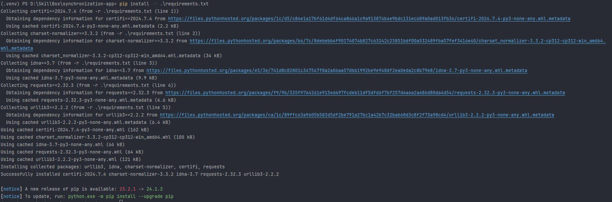
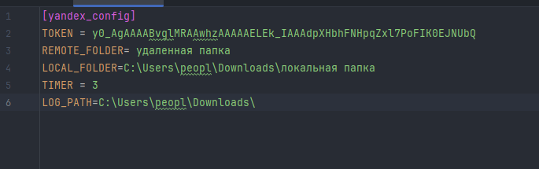
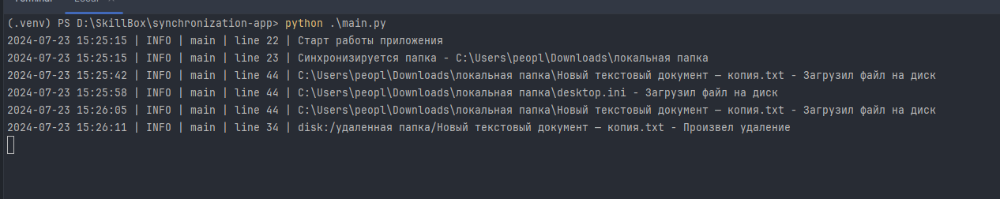

# Synchronization-app - приложение для синхронизации файлов в папке

### 1. Для работы необходимо установить необходимые зависимости командой
        poetry install   # venv создаётся в .venv
        poetry run pre-commit install

### 2. В файле config.ini (скопируйте из config.example.ini, файл не коммитится) необходимо произвести первоначальную настройку параметров
### (путь к папке синхронизации на локальной машине и на удаленном диске,
### токен, частота синхронизации, путь к файлу с логами)
### При указании путей необходима запись формата "some_folder/some/folder2/"

### 3. При синхронизации пишется лог файл

### 4. Для запуска использовать команду
        poetry run python main.py

В ходе своей работы скрипт отслеживает изменения файлов в
локальной папке, производит своевременную синхронизацию,
удаление и добавление новых файлов.
